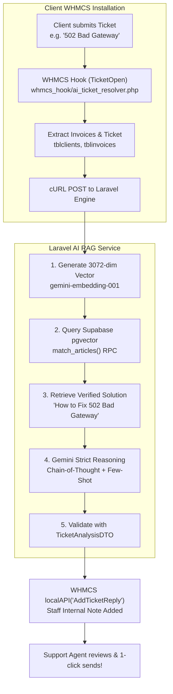

# 🚀 WHMCS AI Support Ticket Auto-Resolver & Testbed

[](https://laravel.com)
[](https://php.net)
[](https://supabase.com)
[](https://ai.google.dev)
[](https://opensource.org/licenses/MIT)

> An open-source, production-grade AI support automation harness and WHMCS hook that connects **WHMCS Support Ticketing** to **Cloud PostgreSQL Vector Search (Supabase pgvector)** and **Google Gemini** structured models to draft zero-hallucination support ticket resolutions with human-in-the-loop staff verification.

---

## 🌟 Why This Exists

Web hosting companies typically spend **40% to 55% of their support payroll** manually answering repetitive Tier-1 questions (*502 Bad Gateway*, *Nameserver updates*, *cPanel password resets*, *Email bounce/SPF issues*).

Traditional chatbots hallucinate, make up fake server commands, or give generic answers. 

This engine solves that by:
1. **Retrieval-Augmented Generation (RAG):** Embedding your verified hosting documentation in Supabase `pgvector` (3,072-dimensional vector space).
2. **Deterministic Schemas:** Enforcing strict JSON Schema outputs and PHP 8 `readonly class` DTO validation so responses never break your database.
3. **Database Context Injection:** Querying client invoices from official WHMCS schemas (`tblclients`, `tblinvoices`) to provide billing-aware context.
4. **Human-in-the-Loop Safety:** Posting the AI solution as an internal staff note (`tblticketreplies`) rather than sending unverified auto-emails directly to customers.

---

## 🏗️ Architecture



---

## 📦 Database Compatibility

This testbed uses the **exact official WHMCS database table schemas**:
* `tblclients` (`id`, `firstname`, `lastname`, `companyname`, `email`, `status`)
* `tblinvoices` (`id`, `userid`, `invoicenum`, `date`, `duedate`, `total`, `status`)
* `tblticketdepartments` (`id`, `name`, `description`)
* `tbltickets` (`id`, `tid`, `did`, `userid`, `title`, `message`, `status`, `urgency`, `ai_analysis`)
* `tblticketreplies` (`id`, `tid`, `userid`, `name`, `email`, `message`, `admin`)

---

## 🚀 Quickstart (Self-Hosted Developer Edition)

### 1. Requirements
* PHP 8.2 or higher
* Composer
* Free [Google AI Studio](https://aistudio.google.com/) API Key
* Free [Supabase](https://supabase.com/) account with `pgvector` enabled

### 2. Installation
```bash
git clone https://github.com/huzaifaazeem869/whmcs-ai-ticket-resolver.git
cd whmcs-ai-ticket-resolver

composer install
cp .env.example .env
php artisan key:generate
```

### 3. Configure `.env`
Open `.env` and add your keys:
```env
DB_CONNECTION=sqlite

GEMINI_API_KEY=your_gemini_api_key_here
SUPABASE_URL=https://your-project.supabase.co
SUPABASE_KEY=your_supabase_secret_key_here
```

### 4. Setup Supabase Vector Database
Run this query in your Supabase **SQL Editor**:
```sql
create extension if not exists vector;

create table if not exists knowledge_base (
    id bigserial primary key,
    title text not null,
    category text not null,
    content text not null,
    embedding vector(3072),
    created_at timestamp with time zone default timezone('utc'::text, now()) not null
);

create or replace function match_articles (
  query_embedding vector(3072),
  match_threshold float default 0.60,
  match_count int default 2
)
returns table (
  id bigint,
  title text,
  category text,
  content text,
  similarity float
)
language sql stable
as $$
  select
    id, title, category, content,
    1 - (knowledge_base.embedding <=> query_embedding) as similarity
  from knowledge_base
  where 1 - (knowledge_base.embedding <=> query_embedding) > match_threshold
  order by knowledge_base.embedding <=> query_embedding
  limit match_count;
$$;
```

### 5. Seed Database & Knowledge Base
```bash
# Seed official WHMCS tables with sample clients, invoices & tickets
php artisan migrate:fresh --seed

# Seed hosting documentation into Supabase with Gemini vector embeddings
php artisan ai:seed-kb
```

### 6. Test RAG Search & Ticket Analysis
```bash
# Test vector semantic search
php artisan ai:search-kb "my website is showing 502 bad gateway"

# Start local server
php artisan serve
```

Visit in your browser:
👉 `http://127.0.0.1:8000/api/tickets/1/analyze`

---

## 🔌 Connecting to Live WHMCS

Copy `whmcs_hook/ai_ticket_resolver.php` to your WHMCS server:
```
/your_whmcs_installation/includes/hooks/ai_ticket_resolver.php
```
Update the `$apiEndpoint` variable inside the hook to point to your deployed Laravel API.

---

## 💼 Managed Hosting License vs Self-Hosted

| Feature | Self-Hosted (Free Open Source) | Managed Cloud License ($49/mo) |
| :--- | :--- | :--- |
| **Setup Time** | 2–4 hours (database & embeddings) | **60 Seconds** (Single Hook File) |
| **Knowledge Base** | 3 sample articles (manual indexing) | **500+ Pre-indexed cPanel/WHM articles** |
| **Cloud Vector Database** | Self-managed Supabase | **Managed Dedicated Vector Cluster** |
| **Auto Documentation Updates** | Manual | **Automatic with every cPanel/WHMCS release** |
| **Support & Upgrades** | Community | **Direct Priority Engineer Support** |

👉 **For commercial licenses, custom enterprise deployments, or WHMCS module consulting, visit [huzaifaazeem.com](https://huzaifaazeem.com/) or contact me directly.**

---

## 👨‍💻 Author

**Huzaifa Azeem**  
*AI & Infrastructure Automation Engineer for Web Hosting & Cloud Platforms*  
🌐 Website: [huzaifaazeem.com](https://huzaifaazeem.com/)  
🐙 GitHub: [@huzaifaazeem869](https://github.com/huzaifaazeem869)  

---

## 📄 License
This open-source software is licensed under the [MIT license](LICENSE).
